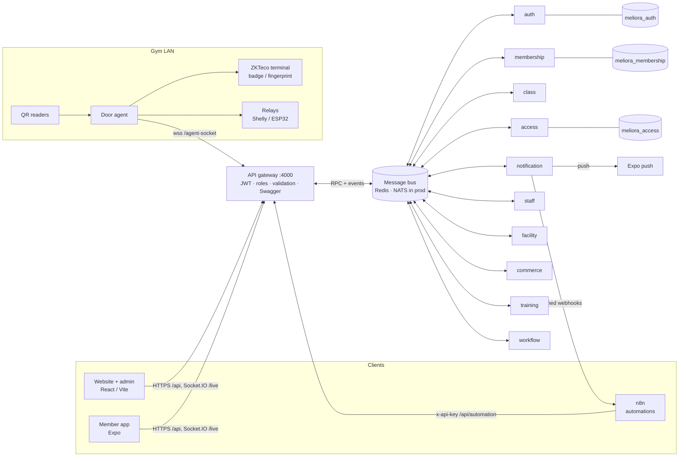

# Meliora Gym — gym management platform


Complete management system for **Meliora Gym** (Khzema Est, Rue Colonel Garnaoui, Sousse — Instagram [@gymmeliora](https://www.instagram.com/gymmeliora/), [Facebook](https://www.facebook.com/p/Meliora-Gym-61589769249533/)):
a public website, an admin back-office, a member mobile app, **automatic door opening** (QR code, app,
RFID badge, fingerprint) and **n8n automations** for customer e-mails and content — on a
**NestJS microservices** backend with **PostgreSQL**.

Languages: French (default), English and Arabic (right-to-left). Currency: TND. Timezone: Africa/Tunis.

---

## Contents
1. [What it does](#what-it-does)
2. [Architecture](#architecture)
3. [Services](#services)
4. [Key flows](#key-flows)
5. [Tech stack](#tech-stack)
6. [Getting started](#getting-started)
7. [Configuration](#configuration)
8. [Security](#security)
9. [Project structure](#project-structure)
10. [Quality and tests](#quality-and-tests)
11. [Git workflow and CI/CD](#git-workflow-and-cicd)
12. [Working with Claude Code](#working-with-claude-code)
13. [Before production](#before-production)

---

## What it does

**Members (mobile app)**
- Account, membership card (plan, days left, renewals), visit history and payments.
- **Rotating QR pass** (changes every 30 s, works offline) and an **"Ouvrir la porte"** button that
  opens the door when the phone is at the gym (geofence).
- Class schedule with **place reservation**: places left, numbered spots (e.g. cycling bikes),
  waitlist with automatic promotion, cancellation deadline, no-show strikes, reminders 2 h before.
- Training: workout programs from the coach, progress charts (weight, body fat, waist, BMI),
  personal-training sessions.
- Push notifications (membership expiring/expired, payment receipt, place freed, class reminder).

**Reception & staff (back-office)**
- Members: search, create (with plan + payment), renew, **freeze**, promo codes, RFID badge, visits.
- Payments, plans, class planning (repeat weekly, spots, waitlist, attendance), desk bookings.
- Access control: doors and controllers online/offline, manual opening, **live access feed**,
  QR scanner page for a reception tablet.
- **CRM**: prospects, free-trial requests from the website, follow-ups, conversion to member.
- **HR**: employees (CIN, CNSS, contracts), **team calendar** (who works when), time clock with
  lateness, leave requests, **payroll** (monthly / hourly / per session + PT commissions).
- **Facility**: rooms ("salles"), equipment with preventive maintenance, maintenance tickets, lockers.
- **Shop / POS**: products, stock (never negative, low-stock alerts), sales and refunds.
- **Workflows & tasks**: build workflows of linked tasks in a visual editor; runs start by hand, on a
  schedule ("Ouverture de la salle" at 5:45) or from events (new member → onboarding, new lead,
  urgent maintenance…); automation tasks can call n8n.

**Owner (dashboard)**
- Members analytics (active, expired, frozen, gender, age groups, sign-ups, churn, renewal rate).
- Team overview (headcount by position, who is on duty now, today's shifts).
- Revenue, check-ins by day and hour, plan mix, expiring memberships.
- **Business KPIs: GMV, NMV, gross margin, operating margin, cash collected, MRR, ARPU** per period
  and per month (memberships + shop − expenses).

**Automations (n8n)**
- Welcome, subscription confirmation, payment receipt, expiry reminder, renewal invite, booking
  confirmations, free-trial confirmation, shop receipt.
- **Motivation e-mails** for members who stop coming (7 / 14 / 30 days, once per absence, optional
  personal sentence written by Claude), birthdays, win-back of expired members.
- Weekly class newsletter, owner daily report, weekly operations digest (leads, low stock,
  maintenance), weekly **Instagram content ideas** drafted with Claude for the owner to approve.

---

## Architecture



- **API gateway**: the single public entry. Verifies JWTs and roles, validates input (class-validator),
  rate-limits, documents everything in Swagger (`/docs`), composes data from several services
  (member detail, dashboard), relays live access events to the back-office and proxies door agents.
- **Microservices** own one business area each and **their own database** (database per service).
  They talk through the bus: request/response for queries and commands, **domain events** for
  everything others must react to (e.g. `member.created` → access read model, onboarding workflow,
  welcome e-mail).
- **Resilience**: access-service keeps a read model of entitlements, so doors keep opening if
  membership-service is down; it is reconciled every 10 minutes. Webhooks go through an outbox with
  retries; booking/reminder jobs are safe with several replicas.
- **Transport**: Redis in development (already on the dev machine); `BUS_TRANSPORT=nats` switches every
  service to NATS with queue groups to run several replicas per service.

---

## Services

| Service | Owns | Database |
|---|---|---|
| `api-gateway` | HTTP API, auth guard, Swagger, live feed, agent proxy, dashboard composition | — |
| `auth-service` | Accounts, roles (ADMIN / STAFF / COACH / MEMBER), JWT sessions with rotating refresh tokens | `meliora_auth` |
| `membership-service` | Members, plans, subscriptions (renewals, freeze), payments, promo codes, CRM leads, stats & KPIs | `meliora_membership` |
| `class-service` | Class sessions, reservations, numbered spots, waitlist, strikes, attendance, reminders | `meliora_class` |
| `access-service` | Doors, door agents, QR / app / badge decisions, access logs, check-in stats | `meliora_access` |
| `notification-service` | n8n webhooks (outbox, HMAC), Expo push, inactive-members feed | `meliora_notification` |
| `staff-service` | Employees, shifts, time clock, leave, payroll | `meliora_staff` |
| `facility-service` | Rooms, equipment, maintenance tickets, lockers | `meliora_facility` |
| `commerce-service` | Products, stock, POS sales, expenses, finance & shop KPIs | `meliora_commerce` |
| `training-service` | Exercise library, workout programs, measurements, PT sessions | `meliora_training` |
| `workflow-service` | Workflow templates (task DAGs), runs, tasks, triggers, automations | `meliora_workflow` |

The full HTTP / socket / webhook contract is in **[docs/API.md](docs/API.md)**; the TypeScript types are in
`backend/libs/common/src/contracts`.

---

## Key flows

**Opening the door**
1. QR: the app computes `MLR1.<memberCode>.<step>.<HMAC>` every 30 s from its access key. A reader on
   the door agent (or the reception scanner) sends it to access-service, which checks the signature,
   the time window, replay and the member's entitlement, then commands the door agent.
2. App button (doors that allow it): the request must come from the gym Wi-Fi when
   `APP_OPEN_ALLOWED_NETWORKS` is set, and the phone's GPS position must be inside the geofence (150 m by
   default); position and IP address are kept in the access log.
3. Badge / fingerprint: the ZKTeco terminal decides locally (the agent keeps its user list in sync
   with active members) and reports punches, which become check-ins.

Every attempt is logged, shown live in the back-office and marks class bookings as attended.

**Membership lifecycle**: member created (identity in auth-service, profile in membership-service,
same id) → subscription + payment → entitlement event to access-service → reminder event N days
before the end → expiry event → n8n e-mails and push at each step.

**Reservations**: booking window → place or numbered spot → waitlist when full → automatic promotion
on cancellation → late cancellations and no-shows count as strikes → too many strikes suspend booking.

---

## Tech stack

| Part | Main technologies |
|---|---|
| Backend | Node 20, NestJS 11 (monorepo, microservices), TypeORM 0.3, PostgreSQL 14+, Redis 7 / NATS, Socket.IO, class-validator, Swagger, Jest |
| Web | React 19, Vite 6, TypeScript, Tailwind CSS 4, React Router 7, TanStack Query 5, Recharts, React Flow, Three.js (react-three-fiber), i18n FR/EN/AR |
| Mobile | Expo SDK 58, React Native 0.88, Expo Router, Reanimated, TanStack Query, expo-location / secure-store / notifications, js-sha256 |
| Door agent | Node 20, TypeScript, socket.io-client, zkteco-js |
| Automations | n8n 2.45, HTML e-mail templates, Claude API for content |
| Ops | Docker (one backend image, compose for everything), pm2 / systemd for the door agent |

---

## Getting started

### Prerequisites
- Node 20 (backend, web, door agent) and **Node ≥ 22.13 for the mobile app** (Expo SDK 58).
- PostgreSQL and Redis running locally (`brew services start postgresql redis`), or Docker.

### Backend
```bash
cd backend
cp .env.example .env          # local: DB_USER = your OS user, empty DB_PASSWORD
npm install
npm run db:create             # one database per service
npm run build && npm start    # gateway + 10 services (or `npm run dev` for watch mode)
curl -s localhost:4000/api/health
npm run seed                  # demo data: plans, staff, 24 members with 12 months of history…
```
API: http://localhost:4000/api · Swagger: http://localhost:4000/docs

Demo logins created by the seed: `admin@meliora-gym.tn` / `ADMIN_PASSWORD` from `.env`,
`accueil@example.com` / `Accueil2026!` (reception), `coach1@example.com` / `Coach2026!`,
members `…@example.com` / `Membre2026!` (the seed prints one).

### Website and back-office
```bash
cd web && npm install && npm run dev      # http://localhost:5173 (admin under /admin)
```

### Mobile app
```bash
cd mobile && npm install
EXPO_PUBLIC_API_URL=http://<your-LAN-IP>:4000 npx expo start   # scan with Expo Go (Docker stack: :8080)
```
Push notifications need an EAS project id (`eas init`) and a development build on Android.

### Door agent (on the gym network)
```bash
cd door-agent && cp .env.example .env     # SERVER_URL + AGENT_KEY (created in Accès → Agents)
npm install && npm run dev                 # or `npm run mock-server` to try without hardware
```
Wiring (maglock / electric strike, relays, fail-safe on escape routes) is described in
[door-agent/README.md](door-agent/README.md).

### n8n
```bash
cd n8n && cp .env.example .env && docker compose up -d     # http://localhost:5678
```
Create the credentials listed in [n8n/README.md](n8n/README.md) and import `n8n/workflows/*.json`.

### Everything with Docker
```bash
cp .env.example .env            # fill in every empty secret (openssl rand -hex 32): compose stops until each is set
docker compose up -d --build    # web + API :8080 · gateway 127.0.0.1:4000 · n8n editor 127.0.0.1:5678
docker compose --profile agent up -d door-agent   # on the gym network
```

---

## Configuration

Backend variables are documented in [backend/.env.example](backend/.env.example) (local) and
[.env.example](.env.example) (Docker). The important ones:

| Variable | Purpose |
|---|---|
| `NODE_ENV` | `production` (Docker) makes the gateway and every service refuse example, weak or reused secrets at startup (below) |
| `JWT_ACCESS_SECRET`, `JWT_REFRESH_SECRET` | Token signing (generate with `openssl rand -hex 32`; two different values) |
| `REFRESH_REUSE_LEEWAY_SECONDS` | How long a refresh token that was just replaced keeps working (two tabs, a retried request); default `30` |
| `ADMIN_EMAIL`, `ADMIN_PASSWORD` | First admin, created when no admin exists. Required in production on first boot (12 characters or more); `Meliora2026!` is only the development default |
| `BUS_TRANSPORT` | `redis` (default) or `nats` |
| `REDIS_PASSWORD`, `REDIS_USERNAME` | Bus password (Redis `--requirepass`, required by docker-compose; empty for a local Redis without one) and optional Redis ACL user (`backend/.env` only) |
| `NATS_TOKEN` | Token of the NATS server and of every service (`BUS_TRANSPORT=nats`, `--profile nats`) |
| `DB_*`, `<SERVICE>_DATABASE_URL` | PostgreSQL connection (one database per service) |
| `N8N_WEBHOOK_URL`, `WEBHOOK_SECRET`, `WEBHOOK_AUTH_TOKEN` | Where events are sent, the key that signs them and their bearer token (two different values). The n8n host of `N8N_WEBHOOK_URL` is also always open to workflow automations |
| `AUTOMATION_API_KEY` | Key n8n uses for `/api/automation/*` |
| `AUTOMATION_ALLOWED_HOSTS` | Extra hosts (`host` or `host:port`, comma separated) workflow automations may call on private networks; any other destination must be public |
| `RELAY_ALLOWED_NETWORKS` | Private networks (CIDR) where door relays called by the server may be; default `10.0.0.0/8,192.168.0.0/16`, narrow it to the relay subnet |
| `APP_OPEN_ALLOWED_NETWORKS` | Public IP / CIDR of the gym Wi-Fi (plus its IPv6 prefix): the app opens doors only from there. Empty = no network check |
| `TRUST_PROXY` | Proxies whose `X-Forwarded-For` the gateway believes (client IP for rate limits and the Wi-Fi check); default `loopback, linklocal, uniquelocal`. On a server inside the gym LAN use a hop count (`1` = nginx, `2` = TLS proxy + nginx) |
| `GATEWAY_BIND`, `N8N_BIND` | Docker: host address of the gateway (4000) and n8n editor (5678) ports, default `127.0.0.1`; clients use the web container (:8080) |
| `GEOFENCE_METERS`, `GYM_LAT`, `GYM_LNG` | App door opening radius and gym position |
| `GYM_PHONE`, `GYM_OPENING_HOURS`, … | Public gym details shown on the website and app |
| `BOOKING_OPENS_DAYS`, `CANCEL_DEADLINE_HOURS`, `NO_SHOW_LIMIT`, … | Reservation policy |

With `NODE_ENV=production` (set by docker-compose and the backend image) the gateway and every service
refuse to start when a secret is an example or trivial value (any `.env.example` value, `change-me…`,
`dev-…`, `secret`, `password`, `admin`), too short (32 characters for keys and tokens, 12 for passwords)
or reused by another variable, e.g. `Configuration de production refusée : JWT_ACCESS_SECRET (valeur
d'exemple). Générez chaque secret avec « openssl rand -hex 32 ».` The message never shows the values. The
root `.env.example` leaves every secret empty, so `docker compose up` stops until each one is set; the
values of `backend/.env.example` only work in development.

> The gym's phone number, opening hours and exact GPS point are placeholders — confirm them with the owner.

---

## Security

What is protected, and how:
- **Accounts and sessions**: passwords hashed with bcrypt, and login takes the same time whether the
  e-mail exists or not. Access tokens live 15 min; refresh tokens are single-use and rotate on every
  refresh, and replaying an old one ends that whole sign-in. Logout and a password change end every
  session of the user; the last active admin cannot be demoted, deactivated or deleted.
- **Roles and rate limits**: every route checks the caller's role (a coach only reaches the tasks of
  their role and unassigned ones). Authentication runs before rate limiting: signed-in callers are
  counted per account, public routes per client IP (login 10/min, register and trial form 5/min). The
  client IP comes from `X-Forwarded-For` only when a trusted proxy sent it (`TRUST_PROXY`).
- **Doors**: rotating QR codes (HMAC, 30 s, single use) whose secret reception can rotate from the
  member file (lost phone); app opening only on doors that allow it, from the gym Wi-Fi and inside the
  geofence, with every attempt logged with its position and IP. Door secrets never reach reception (ADMIN
  sees them masked); terminals only get the badges of members allowed in, and deleted members are disabled.
- **Outbound calls**: workflow automations and door relays called by the server only reach public
  addresses or what you allow (`AUTOMATION_ALLOWED_HOSTS`, `RELAY_ALLOWED_NETWORKS`), never loopback or
  cloud metadata, and never follow redirects.
- **Webhooks to n8n**: a bearer token (`WEBHOOK_AUTH_TOKEN`) plus an HMAC signature of the timestamp and
  body (`WEBHOOK_SECRET`); n8n refuses bad signatures, timestamps older than 5 min and duplicate events.
- **Docker**: Postgres, Redis / NATS and the services share an internal network without a route out
  (only the gateway and the services that call out are also on the edge network); the bus requires
  `REDIS_PASSWORD` (`NATS_TOKEN` with NATS); n8n cannot reach the bus or the databases; the gateway and
  the n8n editor listen on 127.0.0.1 only, and clients go through the web container's nginx.
- **Secrets**: `NODE_ENV=production` refuses example, weak or reused secrets at startup (see
  [Configuration](#configuration)).

Not covered yet (details in `CLAUDE.md`, "Known gaps / gotchas"): until `APP_OPEN_ALLOWED_NETWORKS`
is set, a faked GPS position can open the doors that allow app opening; the outbound check does not
cover DNS rebinding; an access token stays valid up to 15 min after a logout, a password change or a
deactivation.

---

## Project structure
```
gym/
├── backend/            NestJS monorepo
│   ├── apps/           api-gateway + 10 microservices (one folder each)
│   ├── libs/common/    shared contracts, bus, auth guard, utilities
│   ├── scripts/        create-databases, seed, rpc dev tool
│   └── Dockerfile
├── web/                website + back-office (React)
├── mobile/             member app (Expo)
├── door-agent/         on-premises door controller agent
├── n8n/                workflows, e-mail templates, validator
├── docs/API.md         API contract
├── docker/             Postgres init script
├── deploy/             server setup, remote deploy script, release/deploy guide
├── assets/images/      gym photos and logo
├── docker-compose.yml  whole platform (docker-compose.deploy.yml: server override, registry images)
├── .github/workflows/  CI, branch flow, quality checks, deploy (GitHub Actions)
└── .claude/            Claude Code skills, settings and workflows
```

---

## Quality and tests
- Unit tests next to the business rules (Jest): membership state, promo codes, KPI maths, access
  decisions, reservation policy and promotion, payroll, maintenance schedule, workflow graphs…
  `cd backend && npm test`.
- Every service was also exercised live over the bus by its builder, and the whole stack end to end
  through the gateway (auth & roles, dashboards, KPIs, QR scan + replay, geofence, live feed,
  reservations, automation API, door-agent round-trip).
- Web: `npm run build`; mobile: `npx tsc --noEmit`, `npx expo lint`, `npx expo-doctor`; door agent:
  `npm test`; n8n: `npm run check`.
- GitHub Actions runs all of these on every push (`CI`), plus compose validation, actionlint, commit
  message / branch name rules, a secret scan and a dependency audit (`Quality`). Rules and the
  definition of done: `CONTRIBUTING.md`.

---

## Git workflow and CI/CD
```
work branch (feat/…, fix/…, docs/…) ──▶ sandbox ──▶ prod ──▶ main
                                        deploys       deploys    records what
                                        sandbox       production is released
```
- Each change gets a branch from `main`, with scoped conventional commits (`feat(class-service): …`)
  pushed right away. It is merged into `sandbox` (deployed to the sandbox server), then promoted
  `sandbox → prod` (deployed to production, after approval) and `prod → main`.
- `Branch flow` refuses PRs that skip a stage and pushes to `prod`/`main` with commits that did not go
  through the previous stage. `Deploy` runs CI first, builds the images to `ghcr.io`, deploys over SSH,
  checks `/api/health` and rolls back automatically.
- Server setup, GitHub secrets (never in the repo or a chat) and promotion commands:
  [`deploy/README.md`](deploy/README.md).
- Never commit secrets: `.env` files are ignored; `.env.example` files document the variables.

---

## Working with Claude Code
- `CLAUDE.md` (root, `backend/`, `mobile/`, `door-agent/`, `n8n/`) explains the architecture, commands
  and rules to Claude.
- Skills in `.claude/skills/`: run the stack, git workflow, add a microservice / feature, door
  integration, n8n automations, plus `frontend-design` and `webapp-testing`.
- Workflows in `.claude/workflows/`: `meliora-feature` (contract-first delivery with parallel agents
  and review) and `meliora-review` (multi-angle review with adversarial verification).
- `.claude/settings.json`: shared permissions (build/test/git on feature branches; no reading of
  `.env` files, no force-push or push to `main`).

---

## Before production
- [ ] Replace `DB_SYNCHRONIZE` with TypeORM migrations per service (including the `refresh_sessions`
  table and the `doors.allowAppOpen`, `access_logs.context` and `access_members.removedAt` columns).
- [ ] HTTPS in front of the website (TLS proxy → web container :8080); keep `GATEWAY_BIND` and `N8N_BIND`
  on 127.0.0.1. On a server inside the gym LAN, set `TRUST_PROXY` to a hop count.
- [ ] Real secrets: fill every empty value of `.env.example` with `openssl rand -hex 32`, never the same
  value twice (`REDIS_PASSWORD`, `WEBHOOK_AUTH_TOKEN`, and `NATS_TOKEN` with the nats profile included).
- [ ] Set `APP_OPEN_ALLOWED_NETWORKS` to the gym's public IP (and IPv6 prefix); narrow
  `RELAY_ALLOWED_NETWORKS` to the relay subnet.
- [ ] Upgrading an existing deployment: add `REDIS_PASSWORD` and `WEBHOOK_AUTH_TOKEN` and replace every
  example secret (a Postgres password is changed in Postgres first, see `.env.example`); within about
  30 min of the deploy, update the n8n webhook credential and re-import workflow 01
  ([n8n/README.md](n8n/README.md)).
- [ ] After that upgrade: point door agents and phones at :8080 or the public URL instead of :4000, change
  the relay passwords and tokens reception could read before, and expect every user to sign in again once.
- [ ] Run the NATS transport end to end if services are scaled to several replicas.
- [ ] Database backups and monitoring (logs, health checks, alerts).
- [ ] Confirm gym phone, opening hours, GPS point, prices and plan names with the owner.
- [ ] High-resolution logo for the app icon and splash; e-mail logo URL in n8n.
- [ ] Remove the device push token on logout.
- [ ] Test the ZKTeco terminal and relays on site (only simulated so far).

License: private — all rights reserved.
